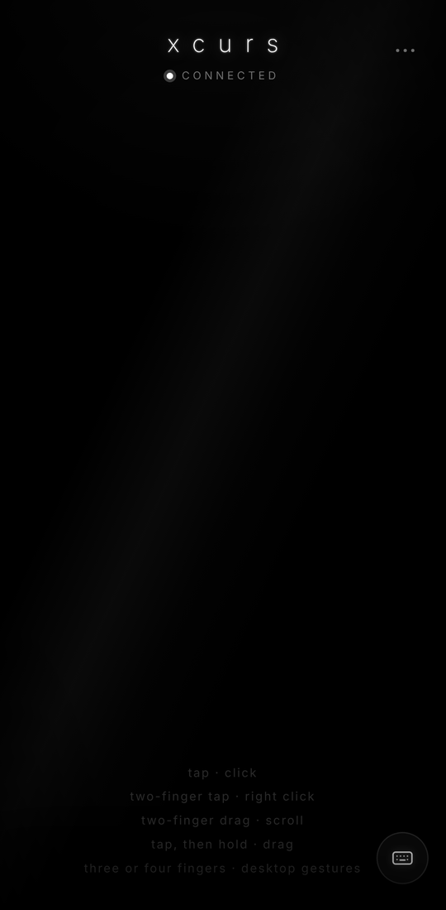
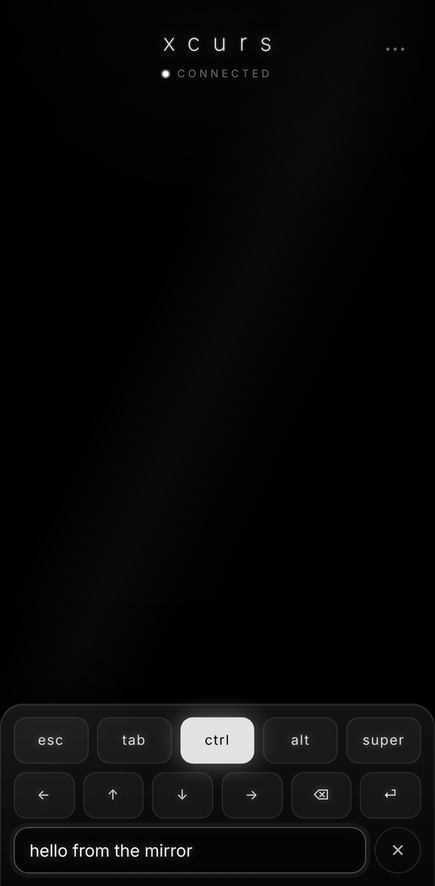
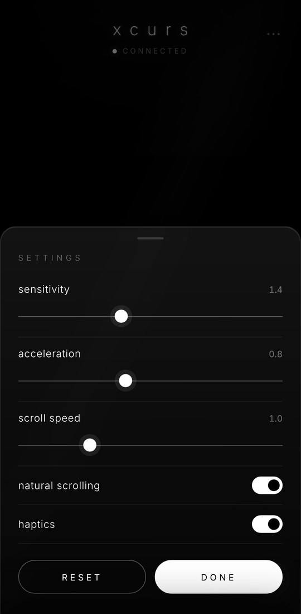

# xcurs

Your phone, as a touchpad for your Linux laptop.

<p align="center">
  
  
  
  
</p>

A small daemon on the laptop creates a virtual mouse, touchpad and keyboard
through the kernel's `uinput` module, so it works on X11 and Wayland, on any
distro. The phone app finds the laptop on your Wi-Fi by itself and turns your
screen into a touchpad.

## Quick install

**Step 1 · Phone:** download the latest APK from
**[Releases](../../releases/latest)** and install it.

**Step 2 · Laptop:**

```bash
git clone https://github.com/ayush00git/xcurs && cd xcurs
./install.sh
```

Then open the app within 2 minutes, on the same Wi-Fi. It pairs on its own.

The installer sets up `uinput` and the `input` group, installs xcurs, opens the
firewall if needed, and runs xcurs in the background at every login. It asks
for `sudo` only where it must; preview every step with `./install.sh --dry-run`.

## Using it

After the first pairing, just open the app.

To pair another phone later, run `systemctl --user restart xcurs` and open the
app within 2 minutes.

No app? Scan the QR code the installer prints, and use the touchpad in your
browser.

| Gesture                      | Does                                   |
|------------------------------|----------------------------------------|
| one finger                   | move                                   |
| tap                          | left click                             |
| tap, then touch and hold     | drag                                   |
| two-finger tap               | right click                            |
| two-finger drag              | scroll                                 |
| three-finger tap             | middle click                           |
| three- or four-finger swipe  | your desktop's touchpad gestures       |
| keyboard icon                | type, plus Esc, Tab, arrows, Ctrl/Alt/Super |

Swipes with 3 or 4 fingers are played on a virtual touchpad, so the desktop
handles them exactly like a laptop touchpad: on GNOME, 3 fingers switch
workspaces or open the overview; on KDE Plasma, 4 fingers do. They need a
Wayland session (X11 desktops mostly ignore touchpad gestures).

**Typing:** tap the keyboard icon and type with your phone's own keyboard
(autocorrect and swipe typing work). The glass keys above it add Esc, Tab, the
arrows, Backspace, Enter, and sticky Ctrl/Alt/Super: tap Ctrl, then type `c`,
for Ctrl+C. Typing assumes the laptop uses a US keyboard layout; other
characters go through Ctrl+Shift+U, which GTK apps understand.

Tap `···` for sensitivity, acceleration and scroll settings.

## Troubleshooting

- **Phone can't find the laptop:** allow it through the firewall:
  `sudo ufw allow 8710/tcp && sudo ufw allow 5353/udp`
  (Fedora: `sudo firewall-cmd --permanent --add-port=8710/tcp`, then
  `sudo firewall-cmd --permanent --add-service=mdns && sudo firewall-cmd --reload`).
- **College or public Wi-Fi** often blocks devices from seeing each other.
  Use your phone's hotspot instead.
- **Pairing window closed:** `systemctl --user restart xcurs`, then open the app.
- **Is it running?** `systemctl --user status xcurs`, logs: `journalctl --user -u xcurs -f`

## Options

```bash
xcurs --pair-window 300   # allow app pairing for 5 minutes after start
xcurs --trust-wifi        # always allow app pairing (trusted networks only)
xcurs --new-token         # unpair every phone
xcurs --no-gestures       # no virtual touchpad (3/4-finger swipes off)
xcurs --dry-run -v        # no mouse, just log events
```

To change how the background service runs, `systemctl --user edit xcurs` and add
(this survives updates):

```ini
[Service]
ExecStart=
ExecStart=%h/.local/bin/xcurs --pair-window 300
```

**Update:** `git pull && ./install.sh`. **Remove:** `./install.sh --uninstall`.

## Development

- Dev setup: `python3 -m venv .venv && . .venv/bin/activate && pip install -e ".[dev]"`
- Tests: `pytest`, and `cd android && ./gradlew test`
- Build the app yourself: `cd android && ./gradlew assembleDebug`
- Release: **Actions → Android release → Run workflow**, then type a version.
  To sign releases with your own key, add the repository secrets
  `XCURS_KEYSTORE_BASE64`, `XCURS_KEYSTORE_PASSWORD`, `XCURS_KEY_ALIAS` and
  `XCURS_KEY_PASSWORD`.

## License

Apache License 2.0. See [LICENSE](LICENSE).
